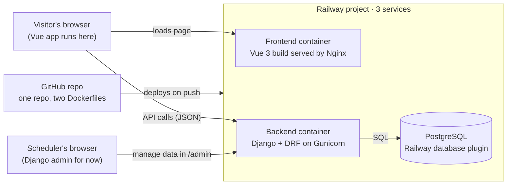

# Referee Scheduling Website — V1 Skeleton Plan

Nov 10, 2026 · Marc-Antoine Dumont
Living version: https://claude.ai/artifact/KaL5vAd2neGrkv6X4GuEQE

## Goal of V1

V1 is a working skeleton: one public URL that shows a page reading real data from a database. Once that chain works end to end, every later feature is just adding pages and tables.

**In scope:** pick the stack, connect the code to the database and hosting, deploy one page that lists upcoming games.

**Out of scope for now:** logins, assigning referees, availability, notifications, payments.

## Technology stack

Decided on Nov 10: Django + PostgreSQL backend, a separate Vue frontend, everything hosted on Railway, code on GitHub. Budget: 5–15 USD per month.

| Layer | Choice | Role | Cost |
| --- | --- | --- | --- |
| Code storage | GitHub, one repo with `backend/` and `frontend/` folders | Version history; Railway deploys each folder on every push | Free |
| Backend | Django 5.2 LTS + Django REST Framework | Data models, business rules, JSON API, built-in admin to manage games and referees | Free (open source) |
| Database | PostgreSQL (Railway plugin) | Stores games, referees, assignments | Included in Railway usage |
| Frontend | Vue 3 + Vite | The pages people see; calls the Django API | Free (open source) |
| Hosting | Railway Hobby plan: 3 services in one project (backend, frontend, Postgres) | Builds and runs everything from GitHub, free HTTPS URLs | 5 USD/mo incl. 5 USD of usage; estimate 5–10 USD total |
| Containers | Docker + Docker Compose; Nginx serves the built Vue site | One command runs backend, frontend and Postgres locally; Railway builds the same Dockerfiles in production | Free (Docker Desktop is free for personal use) |

Supporting Python packages: `gunicorn` (production server), `psycopg` (Postgres driver), `dj-database-url` (reads Railway's database URL), `django-cors-headers` (lets the Vue site call the API), `whitenoise` (serves admin CSS).

Repo layout (decided): one GitHub repo. On Railway, each service is linked to the same repo with its own Root Directory (`backend` or `frontend`) and Watch Paths (`/backend/**` or `/frontend/**`), so a push only redeploys the part that changed.

## How the pieces link together



The Vue page is downloaded from the frontend container, then the browser calls the Django API directly for data. Locally, `docker compose up` runs the same three pieces (frontend, backend, Postgres) on your computer.

## Starter data model

Three Django models express "two referees per game." The first page only reads `Game`. The other two are created now so the shape is ready, and you can fill them through the Django admin.

| Model | Key fields | Rules |
| --- | --- | --- |
| `Game` | starts_at, venue, home_team, away_team, division | One row per game |
| `Referee` | full_name, email, phone, level | One row per referee |
| `Assignment` | game → Game, referee → Referee, slot (1 or 2) | At most 2 per game (unique game + slot); a referee can't take both slots on one game (unique game + referee) |

`backend/scheduling/models.py`:

```python
from django.db import models


class Game(models.Model):
    starts_at = models.DateTimeField()
    venue = models.CharField(max_length=120)
    home_team = models.CharField(max_length=80)
    away_team = models.CharField(max_length=80)
    division = models.CharField(max_length=40, blank=True)

    class Meta:
        ordering = ["starts_at"]

    def __str__(self):
        return f"{self.home_team} vs {self.away_team} ({self.starts_at:%Y-%m-%d %H:%M})"


class Referee(models.Model):
    full_name = models.CharField(max_length=120)
    email = models.EmailField(unique=True)
    phone = models.CharField(max_length=30, blank=True)
    level = models.CharField(max_length=40, blank=True)

    def __str__(self):
        return self.full_name


class Assignment(models.Model):
    SLOT_CHOICES = [(1, "Referee 1"), (2, "Referee 2")]

    game = models.ForeignKey(Game, on_delete=models.CASCADE, related_name="assignments")
    referee = models.ForeignKey(Referee, on_delete=models.PROTECT, related_name="assignments")
    slot = models.PositiveSmallIntegerField(choices=SLOT_CHOICES)

    class Meta:
        constraints = [
            models.UniqueConstraint(fields=["game", "slot"], name="one_referee_per_slot"),
            models.UniqueConstraint(fields=["game", "referee"], name="referee_once_per_game"),
        ]
```

## From zero to a hosted first page

About 2–3 hours the first time. You need Docker Desktop and Git; Python 3.12+ and Node.js 20+ only to generate the two projects once. Everything then runs in containers: locally with Docker Compose, online on Railway from the same Dockerfiles.

- [ ] **Repo:** this folder is the repo; push it to a GitHub repo.
- [ ] **Generate the backend:** in a throwaway virtualenv, `pip install django djangorestframework django-cors-headers gunicorn "psycopg[binary]" dj-database-url whitenoise`, then `mkdir backend && cd backend`, `django-admin startproject config .`, `python manage.py startapp scheduling`, `pip freeze > requirements.txt`.
- [ ] **Generate the frontend:** from the repo root, `npm create vue@latest frontend` (plain JavaScript, no router or store needed yet).
- [ ] **Add the code:** the models above, plus the settings, API, URLs, admin and `App.vue` below.
- [ ] **Add the container files:** `backend/Dockerfile`, `frontend/Dockerfile`, `frontend/nginx.conf.template`, the two `.dockerignore` files and `docker-compose.yml` at the root (all below).
- [ ] **Run locally:** `docker compose up --build`, then `docker compose exec backend python manage.py makemigrations scheduling`, `docker compose exec backend python manage.py migrate` and `docker compose exec backend python manage.py createsuperuser`. Add 2 test games at `http://localhost:8000/admin` and check they show at `http://localhost:5173`. Commit the generated migration file.
- [ ] **Push** to GitHub (`.gitignore`: `.venv/`, `node_modules/`, `.env`, `__pycache__/`).
- [ ] **Railway project:** sign in with GitHub, choose New Project → Deploy from GitHub repo, then add a PostgreSQL database to the same project.
- [ ] **Backend service:** set Root Directory to `backend` and Watch Paths to `/backend/**` (Railway finds the Dockerfile on its own), add the backend variables below, then Settings → Networking → Generate Domain.
- [ ] **Frontend service:** add a second service from the same repo, set Root Directory to `frontend` and Watch Paths to `/frontend/**`, add the variable `VITE_API_URL=https://<backend domain>`, then Generate Domain.
- [ ] **Connect the two:** put the frontend domain into the backend's `CORS_ALLOWED_ORIGINS` and redeploy the backend.
- [ ] **Admin user in production:** open a shell on the backend service (`railway ssh`) and run `python manage.py createsuperuser`.
- [ ] **Check the chain:** add a game in `https://<backend domain>/admin`, refresh the frontend URL, and see it appear.

**Settings changes** (`backend/config/settings.py`). These are the lines to add or replace; the rest of the generated file stays as is:

```python
import os
import dj_database_url

SECRET_KEY = os.environ.get("SECRET_KEY", "dev-only-insecure-key")
DEBUG = os.environ.get("DEBUG", "True") == "True"
ALLOWED_HOSTS = os.environ.get("ALLOWED_HOSTS", "localhost,127.0.0.1").split(",")
CSRF_TRUSTED_ORIGINS = [f"https://{h}" for h in ALLOWED_HOSTS if h not in ("localhost", "127.0.0.1")]
SECURE_PROXY_SSL_HEADER = ("HTTP_X_FORWARDED_PROTO", "https")

INSTALLED_APPS += ["rest_framework", "corsheaders", "scheduling"]

# CorsMiddleware first; WhiteNoise right after SecurityMiddleware
MIDDLEWARE.insert(0, "corsheaders.middleware.CorsMiddleware")
MIDDLEWARE.insert(MIDDLEWARE.index("django.middleware.security.SecurityMiddleware") + 1,
                  "whitenoise.middleware.WhiteNoiseMiddleware")

# Railway (and docker compose) provide DATABASE_URL; falls back to SQLite otherwise
DATABASES = {"default": dj_database_url.config(default=f"sqlite:///{BASE_DIR / 'db.sqlite3'}", conn_max_age=600)}

CORS_ALLOWED_ORIGINS = os.environ.get("CORS_ALLOWED_ORIGINS", "http://localhost:5173").split(",")
STATIC_ROOT = BASE_DIR / "staticfiles"
TIME_ZONE = "America/Toronto"
```

**API** (`backend/scheduling/api.py`):

```python
from django.utils import timezone
from rest_framework import generics, serializers

from .models import Game


class GameSerializer(serializers.ModelSerializer):
    class Meta:
        model = Game
        fields = ["id", "starts_at", "venue", "home_team", "away_team", "division"]


class UpcomingGames(generics.ListAPIView):
    serializer_class = GameSerializer

    def get_queryset(self):
        return Game.objects.filter(starts_at__gte=timezone.now())
```

**URLs and admin** (`backend/config/urls.py` and `backend/scheduling/admin.py`):

```python
# config/urls.py
from django.contrib import admin
from django.urls import path
from scheduling.api import UpcomingGames

urlpatterns = [
    path("admin/", admin.site.urls),
    path("api/games/", UpcomingGames.as_view()),
]

# scheduling/admin.py
from django.contrib import admin
from .models import Game, Referee, Assignment

admin.site.register([Game, Referee, Assignment])
```

**Backend container** (`backend/Dockerfile`). Railway sets `PORT`; locally it defaults to 8000:

```dockerfile
FROM python:3.12-slim
ENV PYTHONDONTWRITEBYTECODE=1 PYTHONUNBUFFERED=1 PORT=8000
WORKDIR /app
COPY requirements.txt .
RUN pip install --no-cache-dir -r requirements.txt
COPY . .
CMD python manage.py migrate && python manage.py collectstatic --noinput && gunicorn config.wsgi --bind 0.0.0.0:$PORT
```

**Frontend container** (`frontend/Dockerfile`). Three stages: `dev` for local hot reload, `build` to compile, `prod` (the last stage, which Railway uses) for Nginx:

```dockerfile
FROM node:20-alpine AS dev
WORKDIR /app
COPY package*.json ./
RUN npm ci
COPY . .
CMD ["npm", "run", "dev", "--", "--host", "0.0.0.0"]

FROM dev AS build
ARG VITE_API_URL
ENV VITE_API_URL=$VITE_API_URL
RUN npm run build

FROM nginx:alpine AS prod
ENV PORT=80
COPY nginx.conf.template /etc/nginx/templates/default.conf.template
COPY --from=build /app/dist /usr/share/nginx/html
```

**Nginx config** (`frontend/nginx.conf.template`). The Nginx image fills in `${PORT}` at startup:

```nginx
server {
  listen ${PORT};
  root /usr/share/nginx/html;
  location / {
    try_files $uri $uri/ /index.html;
  }
}
```

**`.dockerignore`** (one in `backend/`, one in `frontend/`):

```
.venv
__pycache__
node_modules
dist
.env
db.sqlite3
```

**Local stack** (`docker-compose.yml` at the repo root). Code folders are mounted, so edits reload without rebuilding:

```yaml
services:
  db:
    image: postgres:16
    environment:
      POSTGRES_DB: referee
      POSTGRES_USER: referee
      POSTGRES_PASSWORD: referee
    volumes:
      - pgdata:/var/lib/postgresql/data
    healthcheck:
      test: ["CMD-SHELL", "pg_isready -U referee"]
      interval: 3s
      retries: 10

  backend:
    build: ./backend
    command: sh -c "python manage.py migrate && python manage.py runserver 0.0.0.0:8000"
    environment:
      DATABASE_URL: postgres://referee:referee@db:5432/referee
      DEBUG: "True"
    volumes:
      - ./backend:/app
    ports:
      - "8000:8000"
    depends_on:
      db:
        condition: service_healthy

  frontend:
    build:
      context: ./frontend
      target: dev
    environment:
      VITE_API_URL: http://localhost:8000
    volumes:
      - ./frontend:/app
      - /app/node_modules
    ports:
      - "5173:5173"
    depends_on:
      - backend

volumes:
  pgdata:
```

**Backend variables on Railway:**

```bash
DATABASE_URL=${{Postgres.DATABASE_URL}}
SECRET_KEY=<long random string>
DEBUG=False
ALLOWED_HOSTS=<backend domain, e.g. referee-api.up.railway.app>
CORS_ALLOWED_ORIGINS=https://<frontend domain>
```

**First page** (`frontend/src/App.vue`):

```html
<script setup>
import { ref, onMounted } from "vue"

const games = ref([])
const error = ref(false)

onMounted(async () => {
  try {
    const res = await fetch(`${import.meta.env.VITE_API_URL}/api/games/`)
    if (!res.ok) throw new Error(res.statusText)
    games.value = await res.json()
  } catch {
    error.value = true
  }
})

const fmt = (d) =>
  new Date(d).toLocaleString("en-CA", { timeZone: "America/Toronto", dateStyle: "medium", timeStyle: "short" })
</script>

<template>
  <main>
    <h1>Upcoming games</h1>
    <p v-if="error">Could not load games.</p>
    <ul>
      <li v-for="g in games" :key="g.id">
        <strong>{{ g.home_team }} vs {{ g.away_team }}</strong><br />
        {{ fmt(g.starts_at) }} · {{ g.venue }}<span v-if="g.division"> · {{ g.division }}</span>
      </li>
    </ul>
  </main>
</template>
```

`VITE_API_URL` is baked in when the frontend image is built (Railway passes the variable to the `ARG`), so after changing it, redeploy the frontend. Locally the backend uses Postgres in a container, so development matches production.

## After the skeleton

These are candidates for V2. Each one is a decision for you to make, not something already chosen:

- **Assigning referees:** a screen in Vue (or the Django admin at first) to put 2 referees on a game.
- **Logins and roles:** who is the scheduler and who is a referee, and how they sign in.
- **Referee availability:** referees mark the dates they can work.
- **Notifications:** email referees when they are assigned.
- **Custom domain:** about 15–25 CAD per year, connected in Railway settings.
- **Language:** French, English, or both.
